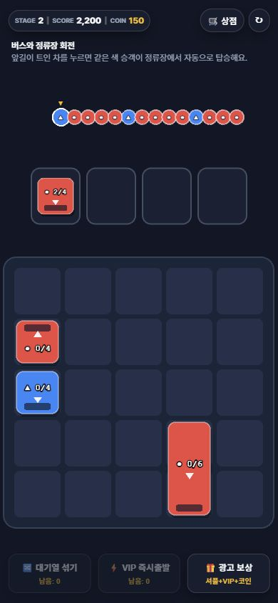

# 진행 중 퍼즐 저장과 부스터 검증

## 구현 (2026-11-17, Windows)

### 셔플·VIP

`src/boosters.js`가 UI와 분리된 상태 변경을 담당합니다. 이동 중인 차량이 있거나 잔량·승객 수가 유효하지 않으면 사용하지 않습니다. 결과를 복제 상태에서 공용 솔버로 확인한 뒤에만 실제 대기열과 사용 횟수를 변경합니다.

- 셔플: 색별 수량과 다른 승객의 총수를 보존하는 무작위 재배열을 최대 8개 검사합니다. 각 후보에 최대 5,000개 탐색 상태를 허용하며 순차 해답이 확인된 변경만 적용합니다. 원래와 같은 배열이나 해답을 확인하지 못한 후보는 차감하지 않습니다.
- VIP: 정류장 차량을 먼저, 이어 주차 차량을 검토합니다. 필요한 동색 승객이 모두 존재하고 VIP 이후 해답이 확인된 차량을 만석 처리합니다. 남은 승객의 상대 순서는 유지합니다. VIP는 주차 경로와 얼음 잠금을 우회하는 부스터입니다. 출발·정류장 해제·점수는 렌더러의 공용 출발 함수에서 한 번만 반영합니다.
- 탐색 예산 내에서 해답을 찾지 못하면 사용 횟수를 유지하고 안내합니다. 이것이 게임 전체에서 불가능하다는 증명은 아닙니다. 물음표 내부 색을 아는 순차 솔버의 한계도 그대로 적용됩니다.

### 저장·복원

저장 Schema v3에 선택적 `round` 필드를 추가했습니다. 기존 v2/v3 저장은 현재 스테이지를 처음부터 시작하며 잔액·인벤토리는 유지합니다. round 내부 버전은 1입니다.

`round-save.js`는 원본 레벨의 정확한 JSON 서명, 차량별 상태·탑승 수·정류장 인덱스·공개/빙결 여부, 남은 승객 배열, 탑승 누계, 터널 누계, 부활 사용 여부를 기록합니다. 점수·부스터 재고·경제 상태는 기존 최상위/메타 필드를 사용합니다. 레벨 서명은 암호학적 서명이 아니라 콘텐츠 일치 확인용 문자열입니다.

복원 시 신뢰할 수 있는 레벨 JSON에서 새 차량을 만들고 검증된 가변 필드만 반영합니다. 저장에 덧붙인 좌표·정원·차량색은 반영하지 않습니다. 차량 ID 중복, 정류장 중복·범위, 탑승 수, 상태 조합, 색별 남은 좌석, 총 승객을 검사합니다. 거부할 때 현재 상태를 부분 수정하지 않습니다. 손상·레벨 변경 시 현재 레벨을 새로 시작하며 안내합니다.

- 출차 중 `MOVING`은 정류장 도착 상태로, 출발 중 `DEPARTING`은 출발 완료 상태로 저장합니다. 애니메이션 시간·좌표는 복원하지 않습니다. 도착한 물음표는 공개됩니다.
- 출차 예약·승객 탑승·출발·실패·부스터·재시작 시 저장하며 백그라운드/페이지 종료 때도 저장을 시도합니다. 웹 localStorage는 Promise를 기다리기 전에 동기 기록합니다.
- 모든 탑승마다 iCloud 요청을 보내지는 않습니다. 클라우드 전달은 시작·부스터/경제 변경·레벨 완료/재시작·백그라운드 등의 체크포인트에서 시도합니다. 전달 접수는 원격 저장 완료를 뜻하지 않습니다.
- 실패 상태는 복원 후 실패 판정을 다시 실행해 재도전/가능한 광고 부활 UI를 엽니다. `reviveUsed`도 유지합니다.
- 최종 만석 시 애니메이션 종료 전에 클리어 보상과 다음 스테이지를 저장합니다. 저장된 완료 직전 퍼즐을 복구하는 경우에도 클리어 판정을 실행합니다. 이미 보상을 받은 저장은 round를 비우므로 같은 스냅샷을 다시 보상하지 않습니다.
- 로컬·네이티브·클라우드 중 읽은 저장에 현재보다 높은 최상위 스키마가 있으면 업데이트 안내 후 플레이·저장을 차단합니다. 저장과 클라우드 쓰기 함수도 별도로 덮어쓰기를 거부합니다. 실행 중 다른 버전이 localStorage를 갱신해도 다음 쓰기에서 감지합니다.

## 자동 검증

`npm run validate:resume` 및 `npm run check`에 포함됩니다. 별도 테스트 프레임워크는 추가하지 않았습니다.

- 20레벨의 검증된 해답을 따라 196개 체크포인트를 직렬화·복원하고 남은 해답을 다시 재생했습니다.
- 각 레벨 시작/중간 지점에서 34개 셔플 적용과 40개 VIP 적용의 승객 보존·재고 차감·이후 클리어를 확인했습니다. 셔플 후보가 검증되지 않은 나머지 시도는 상태와 재고를 유지했습니다.
- 이동 중·일부 탑승·부활 사용·실패 상태 복원, 손상 데이터 거부와 무변경, 신뢰하지 않는 추가 필드 무시를 확인했습니다.
- 재고 없음·이동 중·잘못된 승객 수·탐색 예산 소진 시 무차감을 확인했습니다.
- 플랫폼 검사에서 로컬/네이티브/클라우드 미래 스키마 덮어쓰기 차단, 종료 이벤트를 위한 동기 로컬 기록을 확인했습니다.

## 실제 브라우저 검증

390×844 화면에서 2레벨의 파란 차량을 출차한 뒤 새로고침해 정류장 위치를 확인했습니다. 해당 차량에 VIP를 사용하고 셔플한 뒤 빨간 차량에 2명을 탑승시켰습니다. 다시 새로고침했을 때 2/4 탑승, 섞인 대기열, 사라진 VIP 차량, 점수 2,200, 셔플/VIP 잔량 0이 유지됐습니다. 브라우저 오류·경고는 없었습니다.

## 한계와 다음 작업

임의의 모든 플레이 분기·부스터 조합을 전수 검사한 결과가 아닙니다. 실제 iPhone에서 WKWebView 종료·OS 강제 종료·저장 공간 부족·네이티브 원자적 저장은 Mac 테스트가 필요합니다. 웹의 종료 콜백만으로 비동기 네이티브 쓰기 완료를 보장하지 않습니다. 저장 실패 시 마지막으로 성공한 체크포인트보다 이후 진행은 유실될 수 있습니다.

클라우드 동시 편집·계정 변경·서로 다른 기기의 오프라인 재화 소비 병합과 거래 원장 보존은 별도 출시 필수 작업입니다. 현재 단순 최신 저장/최대 진행도 정책을 무손실 경제 병합으로 해석하지 않습니다. 사용자용 힌트는 [이후 구현](12_Hints_and_Hidden_Colors_QA.md)했으며 사람 대상 난이도 검증은 남아 있습니다.
