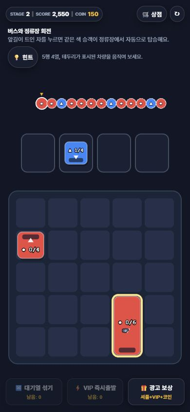

# 게임 내 힌트와 물음표 정보 보호

## 동작 (2026-11-17, Windows)

상단의 무료 **힌트** 버튼으로 현재 상태의 다음 차량 한 대를 요청합니다. 추천 차량에는 굵은 테두리와 손 표시를 붙이고, 안내에 차량 머리 칸의 행·열을 1부터 표시합니다. 색상 기호 모드에서도 동일하게 표시합니다. 힌트는 코인·부스터·광고를 소비하지 않고 차량을 자동 이동시키지 않습니다.

차량 이동·승객 탑승·부스터·재시작·배경 저장 등 상태가 바뀌면 표시와 진행 중 요청을 정리합니다. 같은 상태의 반복 요청은 캐시를 사용합니다. 이동/자동 탑승 중에는 기다리도록 안내하며, 확실한 한 수가 없거나 탐색 한도에 도달하면 추천하지 않습니다. 순차 해답을 찾지 못했다는 이유로 강제 패배를 판정하지 않습니다.

## 물음표 차량 처리

`hint-engine.js`의 투영 함수가 힌트 입력을 허용 목록으로 구성합니다. 미공개 물음표의 `colorId`는 null이며 `colorHex`, 원본 `stageSeed`, 색 스택과 경제 상태는 전달하지 않습니다. 차량의 공개 상태·방향·길이·정원·좌표, 정류장, **전체 남은 승객 배열**은 사용합니다. 화면의 승객 미리보기는 최대 14명이며 힌트는 그 뒤의 배열까지 사용하므로, 화면에 현재 보이는 정보만으로 추론하는 기능이라는 뜻은 아닙니다.

남은 승객의 색별 수량에서 공개 차량의 남은 좌석을 빼서 미공개 차량에 가능한 색 배치를 열거합니다. 미공개 차량의 실제 정답 배치는 참조하지 않습니다. 모든 호환 색 배치에서 추천 차량을 움직인 뒤 부스터 없는 순차 해답이 각각 존재할 때에만 추천합니다. 각 해답은 공용 `puzzle-engine.js`와 `solver.js`의 규칙을 사용합니다.

가능한 배치는 최대 120개, 열거 노드는 10,000개, 해답 탐색은 요청 전체에서 20,000개 방문 상태로 제한합니다. 배치 열거가 중단되면 일부 배치만 보고 추천하지 않습니다. 모든 배치에 공통인 한 수를 확인할 수 없으면 보류합니다. UI는 숨겨진 실제 색 이름이나 해답 전체를 표시하지 않습니다.

## 응답성과 수명 관리

`hint-client.js`가 로컬 모듈 Web Worker인 `hint-worker.js`를 실행합니다. 2.5초를 넘기면 종료하여 메인 화면의 게임 입력을 막지 않습니다. Worker 미지원·오류·파일 로딩 실패도 무차감 안내로 처리하며 동기 무제한 탐색으로 전환하지 않습니다. CSP는 같은 출처의 Worker만 허용합니다.

요청 당시 퍼즐 키와 현재 키가 다르면 결과를 폐기합니다. 취소된 Worker의 늦은 응답은 새 요청을 완료시키지 못합니다. 표시된 추천도 상태가 바뀌면 제거합니다. Worker 파일과 관련 모듈은 오프라인 자산 참조·소스/빌드 HTTP 경로 검사에 포함됩니다.

## 검증

`npm run validate:hints`는 다음을 검사하며 `npm run check`에도 포함됩니다.

- 20레벨의 시작과 검증된 해답 중간 지점, 총 40곳에서 추천을 받았습니다. 각 추천 후 모든 호환 색 배치에서 남은 해답을 재생했습니다.
- 미공개 차량이 남은 16개 검사 지점에서 내부 정답 색·색 코드·원본 시드·스택을 바꿔도 입력 투영과 힌트 결과가 같았습니다.
- 정류장 3칸이 찬 채 두 물음표 중 빨간 차량을 먼저 선택해야 하는 별도 퍼즐에서, 실제 정답을 들여다보고 한 대를 골라 주지 않고 추천을 보류했습니다.
- 상태·잔액·재고 무변경, 이동 중 대기, 손상 상태 거부, 탐색 예산 소진, 중복 요청·취소·늦은 응답·타임아웃·캐시·Worker 오류를 검사했습니다.
- 실제 Worker 모듈을 Node Worker 어댑터로 실행해 import와 메시지 왕복을 확인했습니다.

390×844 브라우저에서는 저장된 2레벨을 재개해 무료 힌트 테두리·행열 안내를 확인했습니다. 반복 요청해도 코인과 부스터는 바뀌지 않았고, 추천 차량을 움직이면 표시가 해제됐습니다. 자동 탑승이 멈춘 뒤 재요청하자 다음 차량으로 갱신됐습니다. 오류·경고 로그는 없었습니다.

## 한계와 다음 작업

여기서 검증한 것은 **한 수 이후, 각 가능한 색 배치에 개별 해답이 존재함**입니다. 이후에도 매 순간 공개 정보만으로 클리어할 수 있는 완전한 의사결정 정책을 증명한 것은 아닙니다. 전체 승객 배열을 읽는 힌트와 달리, 힌트 없이 처음 플레이하는 사람은 추가 정보 제한을 겪습니다. 사람의 초회 승률·시간·물음표 공정성·난이도 곡선 검증은 여전히 필요합니다.

40곳은 대표 체크포인트이며 모든 플레이 분기·모든 부스터 조합을 전수 검사하지 않았습니다. 실제 iPhone의 WKWebView 로컬 번들 Worker/CSP 지원·백그라운드 복귀·성능은 Mac에서 확인해야 합니다. 힌트 때문에 퍼즐 플레이나 구매/광고가 차단되어서는 안 됩니다.
